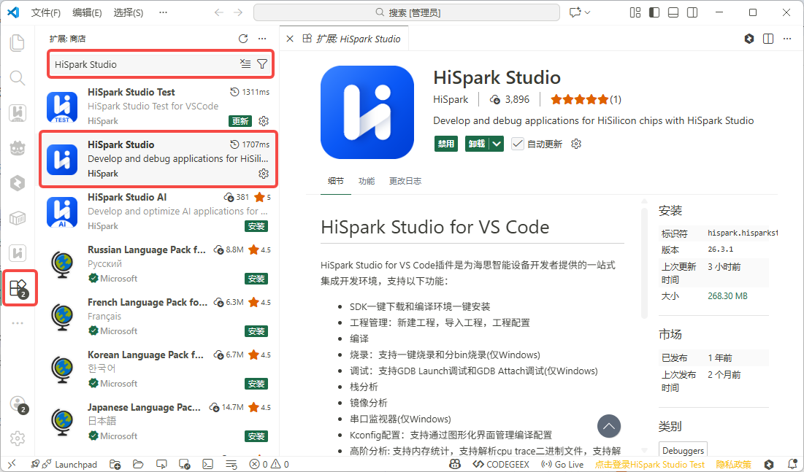
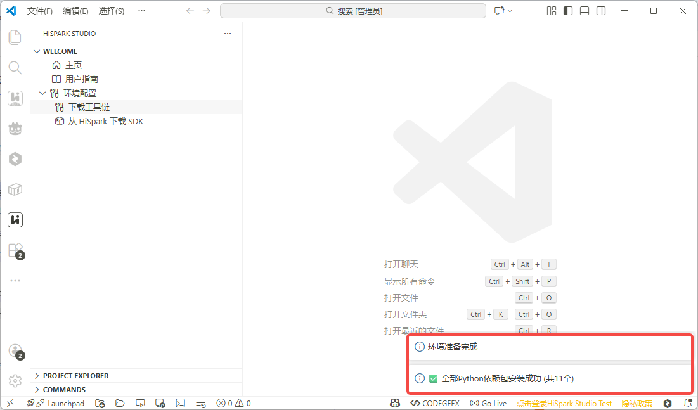
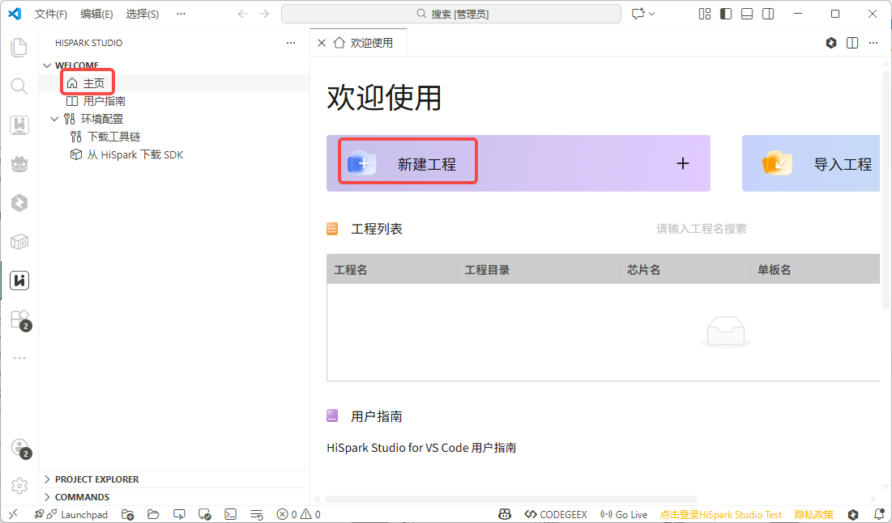
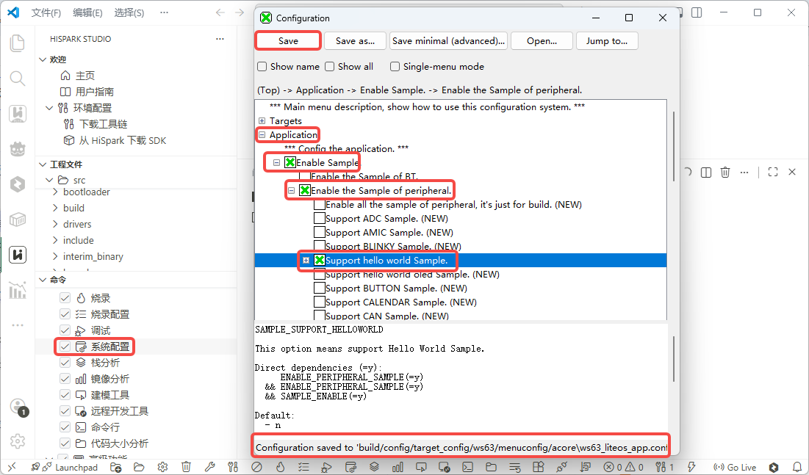
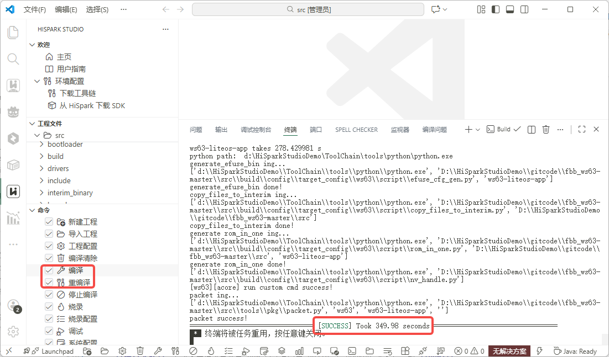
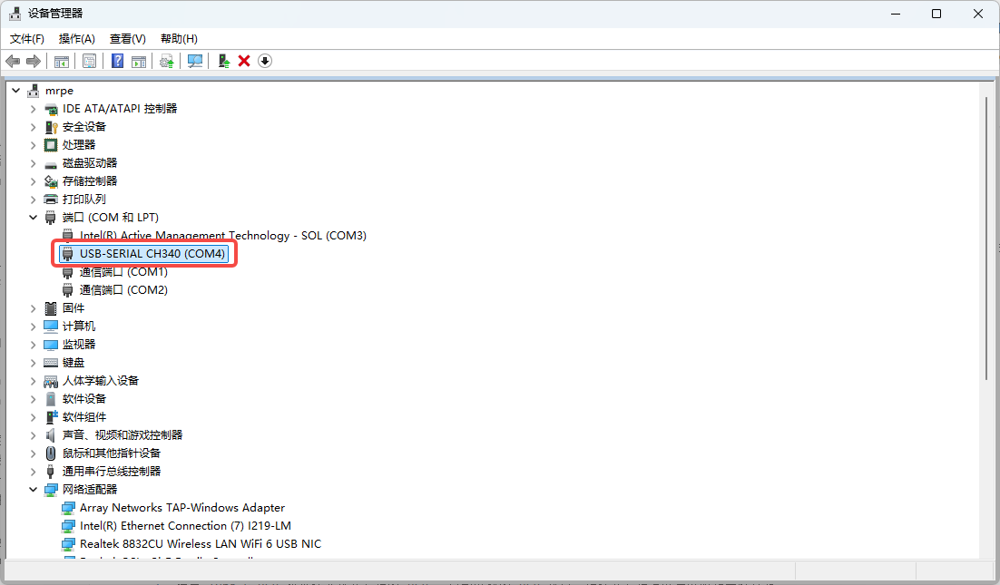
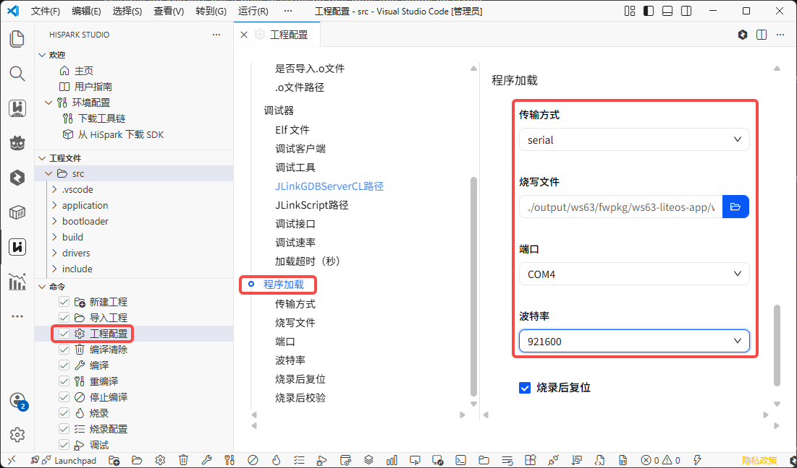
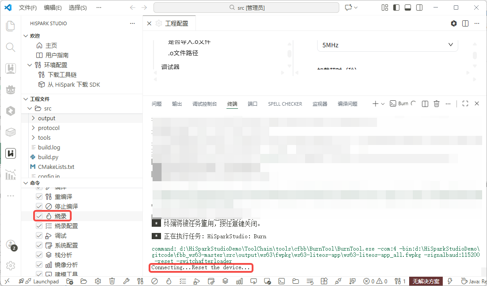
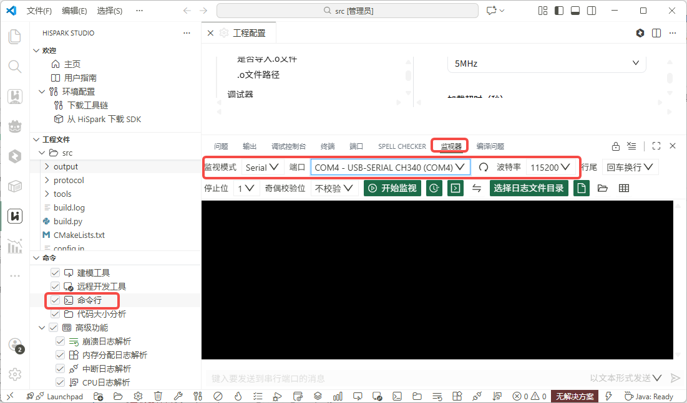
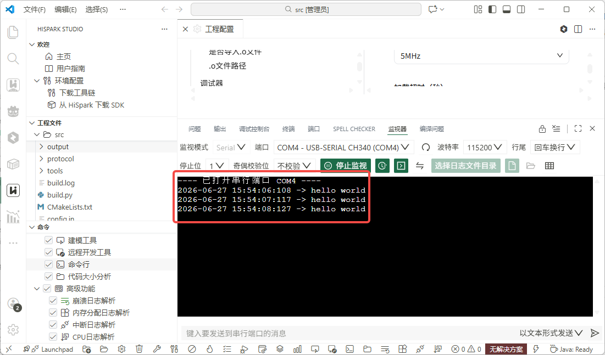

# 使用 VS Code 完成第一次开发

本教程使用 HiSpark Studio for VS Code 完成 WS63 Hello World 的配置、构建、烧录和串口验证。

## 适用范围

| 项目 | 要求 |
| --- | --- |
| 开发主机 | Windows 10/11 64-bit |
| SDK | `1.10.108` 及后续版本 |
| Target | `ws63-liteos-app` |
| 开发板 | [BearPi-Pico H3863 开发板](../board-introduction.md#bearpi-pico-h3863) |
| 工具 | HiSpark Studio for VS Code |
| 示例配置 | `Support hello world Sample` |
| 烧录方式 | `serial` |

## 前置条件

- 使用 Windows 10/11 64 位系统，并可访问网络下载插件、工具链和 SDK。
- 准备 [BearPi-Pico H3863 开发板](../board-introduction.md#bearpi-pico-h3863) 和可传输数据的 Type-C USB 数据线。
- 具有安装 VS Code、扩展和工具链，以及使用串口的权限。
- SDK、工程和工具链保存路径不包含中文字符或空格。

## 操作步骤

### 步骤一：安装 VS Code 和 HiSpark Studio

1. 从 [Visual Studio Code 官方下载页](https://code.visualstudio.com/Download)下载并安装 VS Code 1.85.0 或更高版本。
2. 打开 VS Code 的扩展市场，搜索 `HiSpark Studio` 并安装插件。
3. 单击左侧活动栏中的 HiSpark Studio 图标，确认主页可以正常打开。



遇到安装或插件入口问题时，参见 [Windows（VS Code 插件）环境配置](../environment-setup.md)。

### 步骤二：准备工具链和 SDK

1. 在 HiSpark Studio 主页中单击“下载工具链”，选择一个层级较浅且不含中文字符或空格的目录，等待安装完成。
2. 界面提示“环境准备完成”后，单击“从 HiSpark 下载 SDK”，选择 `WS63 SDK`，将 SDK 保存到一个新的目录。
3. 等待 SDK 下载完成，在工程配置中选择 SDK 的 `src` 目录。



预期结果：HiSpark Studio 不再提示环境缺失，工程配置可以识别芯片 `WS63` 和 Target `WS63-LITEOS-APP`。

工具链或 SDK 下载失败时，参见 [Windows（VS Code 插件）环境配置](../environment-setup.md)中的下载和常见问题。

### 步骤三：创建工程

1. 打开 HiSpark Studio，在“欢迎使用”页面单击“新建工程”。
2. 芯片选择 `WS63`，工程类型选择“示例工程”，软件包选择 SDK 的 `src` 目录；工程名和工程路径使用不含中文且层级较浅的路径。
3. 单击“完成”。如果出现文件夹信任提示，确认信任当前工程。



预期结果：HiSpark Studio 打开新工程，并显示工程文件和命令面板。

### 步骤四：选择 Hello World 配置

1. 在命令面板中打开“系统配置”。
2. 依次进入 `Application` → `Enable Sample` → `Enable the Sample of peripheral`。
3. 启用 `Support hello world Sample`，保存配置。



预期结果：配置文件已生成，且启用了 Hello World 示例。

### 步骤五：构建固件

单击命令面板中的“编译”，等待终端完成构建。



预期结果：终端显示 `SUCCESS`，并生成与当前配置对应的 ELF 和完整固件包。构建失败时，保留终端日志并参见[配置 WS63 开发环境](../environment-setup.md)。

固件包位于：

```text
src/output/ws63/fwpkg/ws63-liteos-app/ws63-liteos-app_all.fwpkg
```

### 步骤六：确认串口

1. 打开 Windows“设备管理器”。
2. 确认开发板上电，记录新出现的 COM 口。



预期结果：设备管理器显示开发板串口，后续烧录和监视使用同一个 COM 口。没有新串口时，参见 [Windows 环境配置中的串口驱动说明](../environment-setup.md#安装串口驱动)。

### 步骤七：烧录固件

1. 在命令面板中打开“工程配置”，进入“程序加载”。
2. 传输方式设置为 `serial`，选择步骤五生成的完整 `.fwpkg`，填入步骤六记录的 COM 口，波特率设置为 `921600`。
3. 单击“烧录”。当终端提示按下复位键时，按开发板上的 `RST` 按钮。





预期结果：终端显示 `All images burnt successfully`。烧录失败时，检查开发板连接、串口和烧录日志。

### 步骤八：打开串口监视器

1. 在命令面板中打开“命令行”，再选择“监视器”。
2. 监视模式选择 `Serial`，选择烧录时使用的 COM 口，波特率设置为 `115200`，单击“开始监视”。



预期结果：监视器开始接收开发板复位后的日志。监视器无法打开时，关闭占用 COM 口的程序后重试。

### 步骤九：确认 Hello World

观察串口日志，确认出现：

```text
start helloworld sample
```

```text
hello world
```

`hello world` 应约每秒输出一次。连续观察到该输出，表示本教程完成。



## 故障处理

- 工程未打开：返回[Windows 环境配置](../environment-setup.md)检查 SDK 路径。
- 编译失败：保留终端日志，确认 Target、SDK 路径和 Hello World 配置。
- 烧录或监视器无法连接：关闭占用 COM 口的程序，确认端口、波特率和开发板供电。
- 未出现 `hello world`：保留构建、烧录和串口日志，检查 Target、固件包和串口配置。

目标板端到端验证完成后，再将页面验证等级更新为 `verified`。
