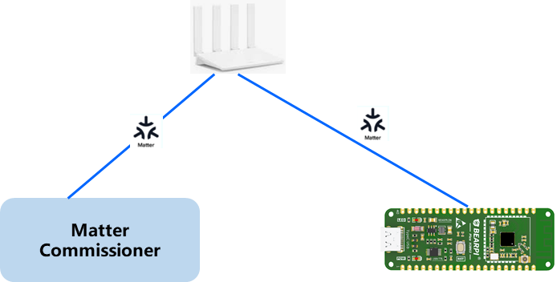
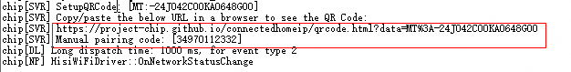
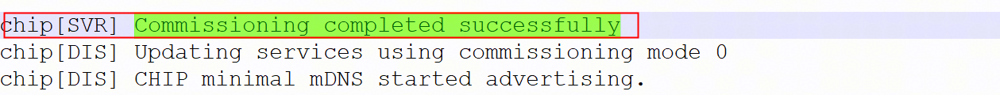
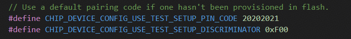

# 前言<a name="ZH-CN_TOPIC_0000002527488484"></a>

**概述<a name="title103mcpsimp"></a>**

本文档主要介绍Matter在WS63V100开发验证操作步骤及使用注意事项等，为软件开发和测试人员在本芯片开发验证Matter提供必要的指导。

> **说明：**
>本文以WS63V100描述为例进行描述。

# Matter概述<a name="ZH-CN_TOPIC_0000002527125016"></a>


## Matter简介<a name="ZH-CN_TOPIC_0000002558124909"></a>

Matter由CSA\(Connectivity Standards Alliance，连接标准联盟\)的工作组开发，是一个统一的开源应用层连接标准，旨在使开发人员和设备制造商能够连接并构建可靠、安全的生态系统，提高联网家庭设备之间的兼容性。它采用经市场验证的技术，使用互联网协议（IP），兼容Thread 和 Wi-Fi网络传输。

Matter技术包含了三份规格书，分别是：

-   Matter Core Specification：核心标准是主要标准，定义了Matter协议架构、安全通信机制、配网流程、数据模型等Matter技术内容。
-   Matter Application Cluster Specification：目前支持的Matter产品应用相关的cluster的详细定义。
-   Matter Device Library Specification：目前支持的Matter设备类型的具体定义，比如设备需要满足的cluster。

它们都可以在CSA官网下载。

> **说明：**
>Matter标准文档下载地址：[https://csa-iot.org/developer-resource/specifications-download-request/](https://csa-iot.org/developer-resource/specifications-download-request/)

## Matter解决方案<a name="ZH-CN_TOPIC_0000002558284891"></a>

本SDK集成了Matter SDK，可以作为Matter Device设备通过Matter Commissioner配网后连接到Matter控制器并由其控制。支持基于SDK开发丰富的Device设备，如灯泡、开关、传感器、恒温器、百叶窗、门锁等。当前方案中提供智能灯具DEMO，供开发者参考。

当前SDK默认支持的Matter SDK版本和标准：Matter V1.4.2。

# 开发环境搭建<a name="ZH-CN_TOPIC_0000002526965084"></a>


## 开发环境说明<a name="ZH-CN_TOPIC_0000002527125018"></a>

-   Matter开发环境：Ubuntu 22.04 LTS
-   Python 3.11或者以上版本

目录说明：

本SDK matter组件位于：

middleware/services/matter/connectedhomeip

matter代码目录结构如下：
```bash
connectedhomeip
   ├── config
   │   └── hisilicon // 本芯片matter代码构建配置目录
   │       ├── mbedtls
   │       └── toolchain
   ├── examples
   │   ├── lighting-app
   │   │   └── hisilicon // 本芯片matter DEMO样例示例代码目录
   │   │       └── main
   │   │           └── include
   │   └── platform
   │       └── hisilicon // DEMO样例示例代码平台公共代码
   │           ├── common
   │           └── ota
   └── src
       └── platform
         └── hisilicon // 本芯片平台matter适配核心代码目录
```
## Matter开发环境搭建步骤<a name="ZH-CN_TOPIC_0000002558124911"></a>

1.  编译开发服务器环境依赖安装。
    ```bash
    sudo apt-get install git gcc g++ pkg-config cmake libssl-dev libdbus-1-dev \
    libglib2.0-dev libavahi-client-dev ninja-build python3-venv python3-dev \
    python3-pip unzip libgirepository1.0-dev libcairo2-dev libreadline-dev default-jre
    ```
2.  下载带本平台适配后的matter源码的ws63 SDK软件包：
    ```bash
    git clone https://gitcode.com/HiSpark/fbb_ws63.git -b master
    cd fbb_ws63
    git submodule update --init --remote --force
    cd src/middleware/services/matter/connectedhomeip
    ./scripts/checkout_submodules.py --shallow --platform hisilicon
    ```
3.  安装Matter编译依赖环境。
    在connectedhomeip目录下执行脚本：
    ```bash
    source scripts/activate.sh
    ```
    注：如果执行脚本过程出现网络连接问题，一般情况下需要配置VPN。
4.  在源码根目录下执行Matter编译命令。
    ```bash
    python3 -u build.py -c ws63-liteos-matter
    ```
    编译生成结果在output目录:
    output/ws63/fwpkg/ws63-liteos-matter/ws63-liteos-matter\_all.fwpkg

Matter详细编译构建环境参考官方指南：[https://project-chip.github.io/connectedhomeip-doc/guides/BUILDING.html](https://project-chip.github.io/connectedhomeip-doc/guides/BUILDING.html)

# 测试验证<a name="ZH-CN_TOPIC_0000002558284893"></a>


## 测试验证说明<a name="ZH-CN_TOPIC_0000002526965086"></a>

Matter应用sample默认支持light app，支持led灯的开和关操作，使用light app来验证Matter SDK本芯片集成适配。

Matter配网图如[图1](#fig12869218103212)所示。

**图 1**  Matter测试组网图<a name="fig12869218103212"></a>


matter commisioner可以是支持matter的手机，以及matter官方提供的调试工具chip-tool等。


### Matter测试验证方法<a name="ZH-CN_TOPIC_0000002527125020"></a>

Matter测试验证支持下列方式：

1.  使用Matter生态设备配网（如Apple Home, Google Home，三方Matter App如涂鸦智能App等）。
2.  使用测试工具chip-tool。

### Matter证书烧写<a name="ZH-CN_TOPIC_0000002558124913"></a>

本芯片Matter解决方案SDK预制了测试证书，Matter连接配网前需要烧写证书。烧写方法：

串口工具输入AT命令：
```bash
AT+MATTERPROVISION
```

注：该测试证书仅供开发调试使用，不支持商用产品使用。

## 使用Matter生态设备配网<a name="ZH-CN_TOPIC_0000002558284895"></a>

以Apple Home为例，测试时支持扫码配对或手工输入配对码进行配对。

开发测试阶段，二维码及手工配对码会在Matter设备启动时打印到串口。



使用Apple Home生态配网Matter设备，详细可以参考Apple官网操作说明：[https://support.apple.com/zh-cn/102135](https://support.apple.com/zh-cn/102135)

配网成功过程，设备端串口有如下关键日志。



## 使用chip-tool测试验证<a name="ZH-CN_TOPIC_0000002526965088"></a>

`chip-tool` 是一个 Linux 命令行工具，可用于配对和控制 Matter 设备。

### 编译 chip-tool

前面的 Matter 开发环境搭建步骤已经完成固件编译所需的环境准备。编译 Linux 主机工具前，进入 `connectedhomeip` 目录，先获取 Linux 平台子模块，再加载 Matter 环境并编译 `chip-tool`：

```bash
cd "$HOME/fbb_ws63/src/middleware/services/matter/connectedhomeip"
./scripts/checkout_submodules.py \
  --shallow \
  --platform linux \
  --recursive \
  --jobs 4
source scripts/activate.sh

./scripts/examples/gn_build_example.sh \
  examples/chip-tool out/host-chip-tool
```

编译结果为：

```text
out/host-chip-tool/chip-tool
```

### 准备 BLE 配网

Ubuntu 中执行下面命令，确认蓝牙控制器存在：

```bash
sudo apt update
sudo apt install -y bluez
bluetoothctl list
```

如果列表中出现 `hci0`，说明 Linux 已识别蓝牙控制器。

### 配对命令<a name="ZH-CN_TOPIC_0000002527125022"></a>

```bash
./chip-tool pairing ble-wifi <node_id> <ssid> <password> <pin_code> <discriminator>
```

在这个命令中：

```text
<node_id> ：用户自定义的被配对设备 ID
<ssid> 和 <password> ：给被配对设备设置的 Wi-Fi 名称和密码
<pin_code> 和 <discriminator> ：设备的 Setup PIN Code 和 Discriminator
```

参考板 Matter 配网示例：

```bash
chip-tool pairing ble-wifi 0x7238 ssid password 20202021 3840
```

`pin_code` 和 `discriminator` 默认值可以在下面的配置文件中查看：



文件路径：

```text
middleware/services/matter/connectedhomeip/src/platform/hisilicon/CHIPDevicePlatformConfig.h
```

可以使用 AT 命令快速查看 `pin_code` 和鉴别码 `discriminator`：

```text
AT+MATTERSHOW
```

在串口输出中查看 PIN Code 和 Discriminator 对应字段。

### 控制 onoff<a name="ZH-CN_TOPIC_0000002558124915"></a>

```bash
chip-tool onoff on/off <node_id> <endpoint_id>
```

在这个命令中：

`<node_id>` 是被控制设备的 ID。

`<endpoint_id>` 是实现了 On/Off cluster 的 endpoint ID。

Matter 方案参考应用控制灯开关：

灯打开：

```bash
chip-tool onoff on 0x7238 1
```

灯关闭：

```bash
chip-tool onoff off 0x7238 1
```

如果设备能够按照命令开关灯，说明 BLE 配网、Fabric 加入和 Matter 基础控制已经成功。

## Matter OTA测试验证<a name="ZH-CN_TOPIC_0000002558304269"></a>

本章在前一章 BLE 配网成功的基础上验证 OTA。OTA 使用两个 Ubuntu 终端和一个 WS63 设备：

| 对象 | 作用 |
| --- | --- |
| Ubuntu 终端 1 | 运行 `chip-ota-provider-app`，保存并提供 Matter OTA 文件 |
| Ubuntu 终端 2 | 使用同一套 `chip-tool` Commissioner 凭据，先完成 WS63 配网，再把 Provider 加入同一个 Fabric，配置 ACL 并发送 OTA 通知 |
| WS63 设备 | Matter OTA Requestor，通过 Wi-Fi/IP 从 Provider 下载并安装 OTA 文件 |

OTA 的完整顺序是：先启动 Provider，让它开始广播；终端 2 使用同一套 `chip-tool` Commissioner 凭据，先完成前一章的 WS63 BLE 配网，再执行 Provider 的配网命令，把 Provider 加入同一个 Fabric；然后通过 `chip-tool` 向 Provider 配置 ACL，最后通知 WS63 使用这个 Provider。必须使用同一套 Commissioner/Fabric 凭据。WS63 下载 OTA 文件时使用 Wi-Fi/IP，BLE 只用于 WS63 的首次配网。

如果尚未安装运行 OTA 所需的系统服务，在 Ubuntu 中执行：

```bash
sudo apt update
sudo apt install -y avahi-daemon  # 提供 mDNS 服务，用于局域网发现 Provider 和 Matter 设备
```

### 编译 chip-ota-provider-app

在已经加载 Matter 环境的终端中执行：

```bash
cd "$HOME/fbb_ws63/src/middleware/services/matter/connectedhomeip"
source scripts/activate.sh
./scripts/examples/gn_build_example.sh \
  examples/ota-provider-app/linux out/host-ota-provider
```

编译结果为：

```text
out/host-ota-provider/chip-ota-provider-app
```

### 1. 构建 WS63 固件并准备版本号

完整的版本 0 → 版本 1 测试需要准备版本 0 固件用于串口烧录，以及版本 1 OTA 镜像用于升级测试。

软件版本宏在：

```text
src/middleware/services/matter/connectedhomeip/src/platform/hisilicon/CHIPDevicePlatformConfig.h
```

打开此文件，将 `#define CHIP_DEVICE_CONFIG_DEVICE_SOFTWARE_VERSION` 中的值改为 `0x0`。然后在 SDK 的 `src` 目录构建版本 0：

```bash
cd "$HOME/fbb_ws63/src"
python3 -u build.py -c ws63-liteos-matter
```

接着把同一版本宏改为 `0x1`，重新构建版本 1：

```bash
cd "$HOME/fbb_ws63/src"
python3 -u build.py -c ws63-liteos-matter
```

两次编译使用同一个输出目录。版本 0 的完整包和版本 1 的签名应用路径如下：

```text
$HOME/fbb_ws63/src/output/ws63/fwpkg/ws63-liteos-matter/ws63-liteos-matter_all.fwpkg
$HOME/fbb_ws63/src/output/ws63/acore/ws63-liteos-matter/ws63-liteos-app-sign.bin
```

`*_all.fwpkg` 用于全量串口烧录；`*-app-sign.bin` 是制作 OTA 的输入。要给设备升级，必须再构建更高版本。

### 2. 制作 Matter OTA 镜像

使用 Matter 源码自带的 `ota_image_tool.py` 将 FOTA 镜像封装为 Matter OTA 镜像。`firmware.bin` 必须替换为设备可以识别的 FOTA 镜像。

```bash
cd "$HOME/fbb_ws63/src/middleware/services/matter/connectedhomeip"
python3 src/app/ota_image_tool.py create \
  -v 0xFFF1 \
  -p 0x8001 \
  -vn 1 \
  -vs "1.0" \
  -da sha256 \
  firmware.bin \
  firmware.ota
```

参数说明：

```text
-v: vid， vendor id
-p: pid, product id
-vn: 软件版本号
-vs: 字符串格式的软件版本号
firmware.bin：Matter OTA 脚本输入镜像，使用 FOTA 镜像作为输入
firmware.ota：Matter OTA 脚本输出镜像，即下文中的 ws63.firmware.ota
```

检查生成的 OTA 镜像：

```bash
python3 src/app/ota_image_tool.py show /path/to/firmware.ota
```

### 3. 烧录设备并准备证书

先把版本 0 的完整包烧到设备。烧录完成并启动设备后，在串口终端执行证书烧录：

```text
AT+MATTERPROVISION
```

看到证书烧录成功后，重启设备，再输入：

```text
AT+MATTERSHOW
```

确认 PIN Code 和 Discriminator。

### 4. 启动 OTA Provider

在 Ubuntu 终端 1 启动 OTA Provider：

```bash
"$HOME/fbb_ws63/src/middleware/services/matter/connectedhomeip/out/host-ota-provider/chip-ota-provider-app" \
  -f /path/to/ota-output/ws63-matter-v1.ota
```

`/path/to/ota-output/ws63-matter-v1.ota` 替换为实际 OTA 文件路径。保持终端 1 一直运行，Provider 会通过 mDNS 广播自己的 Matter 服务，等待终端 2 配网。

### 5. 配网 Provider 并配置 ACL

在 Ubuntu 终端 2 执行下面的命令，将 Provider 加入 Matter 网络：

```bash
"$HOME/fbb_ws63/src/middleware/services/matter/connectedhomeip/out/host-chip-tool/chip-tool" pairing onnetwork 1 20202021
```

这里的 `1` 是 Provider 的 Node ID；`20202021` 是 Provider 的 Setup PIN Code。`onnetwork` 会通过局域网发现已经启动的 Provider，并把它加入当前 `chip-tool` 所使用的 Fabric。

配置 Provider 的 ACL：

```bash
"$HOME/fbb_ws63/src/middleware/services/matter/connectedhomeip/out/host-chip-tool/chip-tool" accesscontrol write acl \
  '[{"fabricIndex":1,"privilege":5,"authMode":2,"subjects":[112233],"targets":null},{"fabricIndex":1,"privilege":3,"authMode":2,"subjects":null,"targets":null}]' \
  1 0
```

ACL 配置完成后，Provider、WS63 和 `chip-tool` 位于同一个 Fabric，WS63 才能访问 Provider 的 OTA Provider cluster。`fabricIndex` 示例为 `1`，如果当前 Fabric 使用其他索引，应按实际 ACL 输出修改。

### 6. 发起并验收 OTA

先读取升级前版本：

```bash
"$HOME/fbb_ws63/src/middleware/services/matter/connectedhomeip/out/host-chip-tool/chip-tool" basicinformation read software-version 0x7238 0
```

必须看到 `SoftwareVersion: 0`。如果已经是 1，不能再次发送版本 1，应制作版本 2。

发送 OTA Provider 通知：

```bash
"$HOME/fbb_ws63/src/middleware/services/matter/connectedhomeip/out/host-chip-tool/chip-tool" otasoftwareupdaterequestor announce-otaprovider 1 0 0 0 0x7238 0
```

参数顺序是：

```text
Provider Node ID       1
Provider Vendor ID     0（测试值）
Announcement Reason    0
Provider Endpoint ID   0
Requestor Node ID      0x7238
Requestor Endpoint ID  0
```

通知成功后，观察 WS63 的串口日志。完整 OTA 应出现下载、SHA-256 校验、写入、重启和 `Saving new software version: 1` 等日志。设备重启后，再次查询：

使用同一个 Fabric 查询 Matter Basic Information，确认设备重启后的软件版本：

```bash
"$HOME/fbb_ws63/src/middleware/services/matter/connectedhomeip/out/host-chip-tool/chip-tool" basicinformation read software-version 0x7238 0
```

串口和 Matter 查询都显示版本 1，且 Provider 日志出现设备的请求和文件传输，才算完整 OTA 成功。

### 7. 常见问题

| 现象 | 检查方法 |
| --- | --- |
| `chip-tool` 找不到设备 | 先确认设备 `AT+IFCFG` 有 IP，Ubuntu 与设备在同一局域网，mDNS 服务可用 |
| BLE 找不到设备 | 确认 Ubuntu 有 `hci0`、设备正在广播、PIN 和 Discriminator 正确 |
| Provider 没收到 `QueryImage` | 检查 Provider 与 WS63 是否同一 Fabric、ACL 是否包含 `0x7238`、`--interface-id` 是否正确、Ubuntu/WSL 入站防火墙是否放行 |
| `announce-otaprovider` 成功但没有下载 | 该返回值只表示通知送达；继续看 Provider 是否收到请求和 WS63 是否能访问 TCP/UDP 5540 |
| OTA 被拒绝 | OTA 版本必须高于当前版本，VID/PID 必须匹配，输入必须是 `.ota` 而不是 `.fwpkg` |
| 两次测试互相影响 | 清除旧的 chip-tool 测试状态后重新配网，确保 Provider、WS63 和 chip-tool 使用同一个 Fabric；不要混用多个 Fabric 的凭据 |

### TH测试<a name="ZH-CN_TOPIC_0000002558284897"></a>

为了简化Matter设备的测试和认证过程，连接标准联盟开发了一套标准化的测试工具，即Matter Test Harness。随着Matter发展至V1.5版本，Matter的测试工具Test Harness也在同步更新，目前联盟已经不再提供完整的最新Test Harness镜像文件，而是完全开源，可以在GitHub上获取代码自行安装。

详细可参考官方文档：[https://matter.cn/development/test-harness](https://matter.cn/development/test-harness)

# 常用开发调试命令<a name="ZH-CN_TOPIC_0000002526965090"></a>


## 常用开发调试命令<a name="ZH-CN_TOPIC_0000002527125024"></a>


### 烧写证书<a name="ZH-CN_TOPIC_0000002558124917"></a>

命令：
```bash
AT+MATTERPROVISION
```
作用：Matter参考设备默认没有证书，需要通过此命令烧写测试证书

备注：烧写完成后需重启设备；客户侧若自行实现证书烧写工具，需保证证书和密钥存储在NV区域中，对应的keyId如下：

证书声明DC：0x6002

设备证书DAC：0x6003

中间证书PAI：0x6004

DAC私钥：0x6005

DAC公钥：0x6028

### 恢复出厂设置<a name="ZH-CN_TOPIC_0000002558124918"></a>

命令：
```bash
AT+MATTERRESET
```
作用：重置Matter配网信息及Matter证书，便于开发测试重新配网及证书验证。

### 显示Matter配置信息<a name="ZH-CN_TOPIC_0000002526965092"></a>

命令：
```bash
AT+MATTERSHOW
```
作用：显示Matter设备配置信息，如pin code、鉴别码等。

### 查看单板网络ip信息<a name="ZH-CN_TOPIC_0000002527125026"></a>

命令：
```bash
AT+IFCFG
```
作用：查看单板网络信息，设备是否接入到路由热点，是否正确分配到IP地址。

### PING命令<a name="ZH-CN_TOPIC_0000002558124919"></a>

-   命令：
```bash
    AT+PING
```
作用：测试IPV4网络连接。
示例：`AT+PING=192.168.3.1`   执行`ping 192.168.3.1`

-   命令：
```bash
AT+PING6
```
作用：测试IPV6网络连接。
示例：`AT+PING6=2001:a:b:c:d:e:f:b`

### 查看系统信息<a name="ZH-CN_TOPIC_0000002558284901"></a>

命令：
```bash
AT+SYSINFO
```
作用：查看系统所有线程状态，如优先级，堆栈状态，内存、CPU使用状态，方便查看和定位问题

# Matter常见问题（FAQ）<a name="ZH-CN_TOPIC_MATTER_FAQ"></a>

## 哪些安装失败需要开启VPN

Matter环境准备会下载Git子模块、CIPD工具包和Python依赖。是否需要VPN，首先看失败发生在下载阶段还是本地安装阶段。

**通常需要开启VPN或配置WSL代理的情况：**

- 执行 `git clone`、`git submodule update` 或 `checkout_submodules.py` 时出现 `Failed to connect`、`Could not resolve host`、`Connection timed out`、`curl: (28)` 或返回 `000`。
- 执行 `source scripts/activate.sh` 时，CIPD无法连接下载服务，出现下载超时、域名解析失败、连接被拒绝或多次重试失败。
- 安装Python依赖时出现 `Read timed out`、`Temporary failure in name resolution`、`Could not fetch URL` 或 `Max retries exceeded`。
- 初始化Matter环境时，GN工具通过CIPD下载失败，随后执行编译出现 `gn: not found`。

**通常不需要通过VPN解决的情况：**

- `lstat ... qMemTags.html: no such file or directory`：通常是CIPD在Windows挂载盘解包导致，应将SDK和环境移到WSL的Linux文件系统。
- `ImportError: cannot import name 'get_loader' from 'pkgutil'`：是旧版 `pgi` 与Python版本不兼容，应使用Python 3.11或跳过 `pgi`。
- `error: externally-managed-environment`：是系统Python禁止直接安装第三方包，应使用虚拟环境，或仅编译固件时使用 `--platform none`。

**需要根据前面日志判断的情况：**

- `gn: not found` 本身不能直接判断是否需要VPN。
- 如果前面的环境初始化日志出现CIPD下载超时、域名解析失败或连接失败，需要开启VPN或配置WSL代理，然后重新执行环境初始化。
- 如果环境初始化没有网络错误，但执行 `source scripts/activate.sh` 后仍然找不到GN，应检查是否在正确的 `connectedhomeip` 目录、环境是否已激活，以及GN所在目录是否已加入PATH。

注意：Windows显示VPN已连接，不代表WSL流量一定经过VPN。只有WSL中的网络检查也能访问依赖下载地址时，后续安装才具备网络条件。

---

## WSL中VPN已连接，但GitHub、GitCode或ZAP/CIPD下载超时

Windows显示VPN已连接，但WSL中执行网络检查时出现：

```text
curl: (28) Failed to connect ...
000
```

**原因：** `curl` 返回 `000` 表示没有收到HTTP响应，不是目标网站返回的HTTP状态码。Windows主机的VPN连接成功，也不代表WSL2的NAT网络流量一定经过VPN。VPN分流策略、DNS、代理、系统防火墙或目标域名限制都可能造成此现象。

**检查方法：**

Windows PowerShell：

```powershell
curl.exe -I --connect-timeout 10 https://github.com
curl.exe -I --connect-timeout 10 https://gitcode.com
curl.exe -I --connect-timeout 10 https://chrome-infra-packages.appspot.com
```

WSL：

```bash
curl -I --connect-timeout 10 https://github.com
curl -I --connect-timeout 10 https://gitcode.com
curl -I --connect-timeout 10 https://chrome-infra-packages.appspot.com
getent hosts github.com gitcode.com chrome-infra-packages.appspot.com
env | grep -i proxy
git config --global --get-regexp 'http.*proxy'
```

**判断方法：**

- Windows成功、WSL超时：VPN没有正确接管WSL网络，或WSL的DNS/代理配置不正确。
- Windows和WSL都超时：VPN、系统防火墙、网络出口或目标域名仍被拦截。
- 返回 `200`、`301`、`302`、`403` 或 `404` 都说明已经收到HTTP响应，网络路径基本可用。
- `000` 且连接超时，说明连接没有建立。

Matter依赖下载不只访问GitHub，还可能访问GitCode、CIPD和ZAP相关服务，因此需要分别检查这些域名。使用代理时，应在WSL中为 `curl`、`git` 和 `pip` 配置同一个可访问的代理。

---

## CIPD在`/mnt/d`解包时报`qMemTags.html`不存在

典型错误如下：

```text
failed to install fuchsia/third_party/armgcc/linux-amd64
lstat .../.environment/cipd/packages/.../share/doc/gdb/qMemTags.html:
no such file or directory
```

**原因：** `/mnt/d` 是WSL访问Windows D盘的NTFS挂载路径，不是WSL的Linux文件系统。CIPD解包ARM GCC、ZAP等工具包时会并发处理大量文件，并可能涉及文件属性、符号链接、大小写和重命名。在 `/mnt/d` 上解包可能导致文件不完整或 `lstat` 找不到文件。

这个错误属于本地文件系统兼容问题，即使VPN已经连接也不能直接解决。`qMemTags.html` 通常只是第一个暴露问题的文件，不代表GDB源码本身损坏。

**解决方案：** SDK、Matter `.environment` 和CIPD缓存都放到Linux文件系统中：

```text
$HOME/fbb_ws63
$HOME/fbb_ws63_matter_environment
$HOME/.cipd-cache-dir
```

推荐直接在Linux文件系统中重新克隆：

```bash
cd "$HOME"
git clone https://gitcode.com/HiSpark/fbb_ws63.git
```

如果需要使用已有SDK，请先将其复制到Linux文件系统中的目录，再进入该副本的
`src/middleware/services/matter/connectedhomeip` 子目录。不要从Windows挂载盘中的SDK目录执行Matter环境安装或编译。

如果挂载盘中的 `.environment` 已经解包失败，应在Linux路径中重新生成环境。确认路径时，`pwd` 必须以 `/home/`、`/opt/` 等Linux文件系统路径开头；以 `/mnt/` 开头仍然是Windows挂载盘。

---

## 已显示`Environment passes all checks`，为什么后面仍然失败

执行Matter环境脚本时可能看到：

```text
Environment passes all checks!
Environment looks good, you are ready to go!
Installing pip requirements for all...
```

**原因：** `Environment passes all checks!` 只表示Pigweed完成了当前阶段的环境检查，例如工具路径、CIPD基础环境和必要环境变量检查通过。它不是整个 `source scripts/activate.sh` 流程的最终成功标志，也不代表后续所有Python包和CIPD工具包已经安装成功。

脚本后面还可能执行：

- 额外平台Python依赖安装；
- `pgi`、`dbus-python`、`PyGObject` 等Linux控制器依赖安装；
- CIPD工具包补充安装。

如果后续出现网络超时、域名解析失败或CIPD下载失败，先按本FAQ前面的VPN检查方法处理；如果出现本地路径、Python版本或系统Python错误，则按对应FAQ处理。

因此，如果这句话后面继续出现 `error`、`failed` 或Python traceback，整体环境准备仍然失败。

**验证方法：** 当前WS63 Matter固件编译建议执行：

```bash
cd "$HOME/fbb_ws63/src/middleware/services/matter/connectedhomeip"
source scripts/activate.sh --platform none

command -v gn
command -v ninja
gn --version

cd "$HOME/fbb_ws63/src"
fbb build ws63-liteos-matter
```

只有以下条件同时满足，才可以认为环境真正可用于编译：

1. `source scripts/activate.sh --platform none` 后没有新的Python traceback或pip安装错误。
2. `command -v gn` 和 `command -v ninja` 能找到Linux环境中的工具。
3. `gn --version` 能正常执行。
4. `fbb build ws63-liteos-matter` 能进入并完成Matter的GN/Ninja编译阶段。

---

## WSL编译Matter时pgi安装失败

!!! warning "重要：pgi必须使用Python 3.11"
    对当前仓库锁定的 `pgi==0.0.11.2`，Python 3.11 是最后推荐且可复现的兼容环境。Python 3.12/3.13不是本文的兼容基线，Python 3.14已明确不兼容；如果只编译WS63 Matter固件，请使用 `--platform none` 跳过 `pgi`。

执行 `source scripts/activate.sh` 时，可能出现以下错误：

```text
Installing pip requirements for all...
python setup.py egg_info did not run successfully
ImportError: cannot import name 'get_loader' from 'pkgutil'
metadata-generation-failed
```

**原因：** Matter的Linux Python依赖中包含旧版 `pgi`，当前仓库锁定的版本为 `pgi==0.0.11.2`。该版本使用了 `pkgutil.get_loader`，而Python 3.14已经移除了这个接口，因此会在生成 `pgi` 包元数据时失败。

`pgi` 是Linux主机侧的Python依赖，用于Matter控制器的BlueZ/GObject蓝牙功能，不是WS63固件的C/C++编译库。Matter代码优先使用 `gi.repository`，`pgi` 只是旧的回退依赖。

如果日志是下载超时、域名解析失败或 `Could not fetch URL`，先检查VPN或WSL代理；如果已经下载到 `pgi` 并出现 `pkgutil.get_loader` 错误，则与VPN无关，是Python版本兼容问题。

**解决方案：** 当前只编译WS63 Matter固件时，跳过额外平台依赖：

```bash
cd "$HOME/fbb_ws63/src/middleware/services/matter/connectedhomeip"

unset PYTHONHOME
unset PYTHONPATH

source scripts/activate.sh --platform none

cd "$HOME/fbb_ws63/src"
fbb build ws63-liteos-matter
```

如果需要使用Matter Linux Controller或 `chip-repl`，请固定使用Python 3.11独立虚拟环境，并优先使用 `PyGObject`/`gi.repository`。`--break-system-packages` 只能绕过系统Python的安装限制，不能解决旧版 `pgi` 与Python 3.14的接口兼容问题。

如果日志显示环境检查通过，但后面紧跟 `pgi` 安装失败，应使用 `--platform none`，或使用Python 3.11重新准备需要完整控制器依赖的环境。
