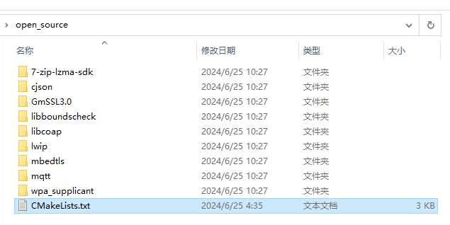
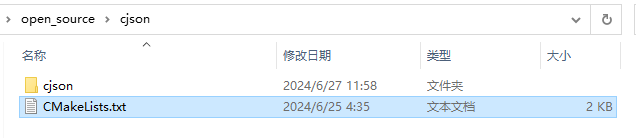
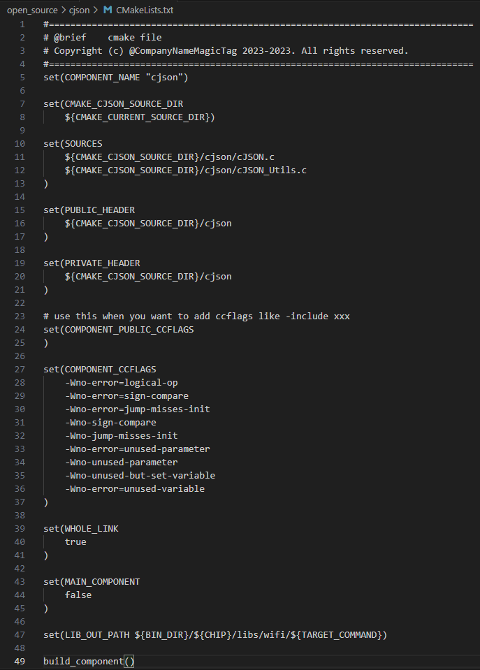
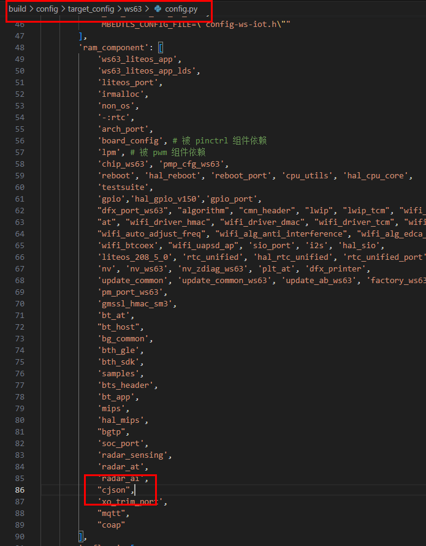

# 前言<a name="ZH-CN_TOPIC_0000001834645229"></a>

**概述<a name="section4537382116410"></a>**

本文档详细的描述了WS63V100移植第三方软件到SDK中的构建操作指导，同时提供了常见的问题解答及故障处理方法。

# 移植指引<a name="ZH-CN_TOPIC_0000001788005284"></a>


## 概述<a name="ZH-CN_TOPIC_0000001787902676"></a>

WS63V100的SDK使用CMake作为构建工具，因此建议使用CMake进行第三方库的移植，从而保证编译的完整性和连贯性。其主要文件编译依赖CMakeLists.txt文件，当需要新增并编译第三方组件时，需要对CMake框架进行修改新增，即修改CMakeLists.txt。

## CMake构建<a name="ZH-CN_TOPIC_0000001788062352"></a>

以移植cjson为例（SDK已集成该组件，可以参考对应文件的修改），移植的步骤如下：

1.  将第三方组件放置于 `src/open_source/` 目录下（例如：`src/open_source/cjson/cjson`，新增一层路径便于对文件路径处理）。
2.  在 `src/open_source/` 目录下，找到本层级的CMakeLists.txt，在该文件内新增一行

    ```
    add_subdirectory_if_exist(cjson)
    ```

    即可将对应的 `src/open_source/cjson` 路径新增到编译框架中。

    

3.  对新增组件内部 `src/open_source/cjson` 路径的CMakeLists.txt进行修改（可参考已有的第三方组件）。

    设置组件名称：

    ```
    set(COMPONENT_NAME "cjson")
    ```

    将xxx.c加入到编译：

    ```
    set(SOURCES xxx.c)
    ```

    私有头文件引用路径：

    ```
    set(PRIVATE_HEADER yyy)
    ```

    私有编译参数：

    ```
    set(COMPONENT_CCFLAGS zzz)
    ```

    设置输出路径：

    ```
    set(LIB_OUT_PATH ...)
    ```

    

    

4.  现在，已经成功将一个名为“cjson”（COMPONENT\_NAME）的组件新增到框架中了，最后应开启对该组件的编译。通过修改“build/config/target\_config/ws63/config.py“中对应的target的“ram\_component”，将需要编译的组件加入到编译流程中。例如：

    想要编译的target名称为“ws63-liteos-app”，则找到“ws63-liteos-app”字典下的ram\_component，在该数组中新增值“cjson”，当启动“ws63-liteos-app”的编译时（使用IDE启动构建，或使用python build.py编译），CMake就会尝试编译“cjson”（SOURCES）。

    

# 常见问题<a name="ZH-CN_TOPIC_0000001834701941"></a>

本章节对用户常见的编译问题进行收集整理，并为用户提供基本的参考。


## CMake基本语法<a name="ZH-CN_TOPIC_0000001834946241"></a>

除了上文提到的“COMPONENT\_NAME”、“SOURCES”、“PRIVATE\_HEADER”、“COMPONENT\_CCFLAGES”、“LIB\_OUT\_PATH”之外，还可以定义公共头文件、公共编译参数等。

用户可参考标准CMakeLists.txt的开发流程，对SDK进行定制化修改。

若在三方组件中已有CMakeLists.txt可进行调用，也可以在 `src/open_source/` 路径下的CMakeLists.txt中将文件夹直接通过add\_subdirectory\_if\_exist\(xxx\)加入编译。

## 头文件引用问题<a name="ZH-CN_TOPIC_0000001788306644"></a>

当用户在开发过程中需要引用新增第三方组件的头文件时，可以在第三方组件的CMakeLists.txt中指定公共的头文件。

例如，需要引用cjson组件下的“cJSON.h”（实际上已全文件引用，仅作参考），则需要在 `src/open_source/cjson` 中的CMakeLists.txt增加：

```
set （PUBLIC_HEADER ${CMAKE_CURRENT_SOURCE_DIR}/cjson/cJSON.h）
```

