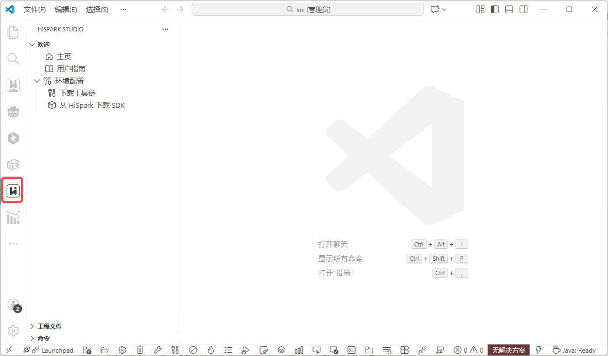
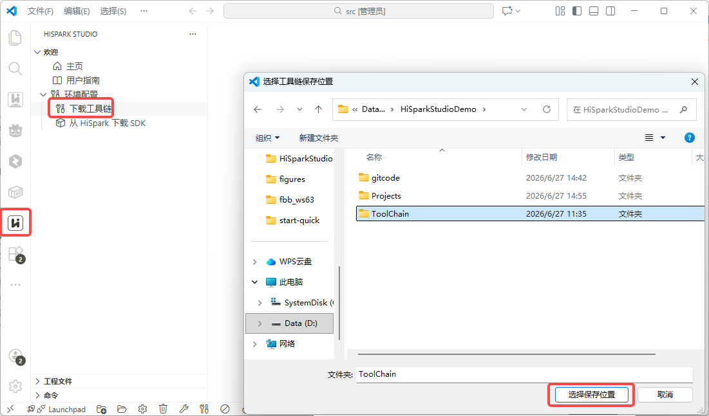
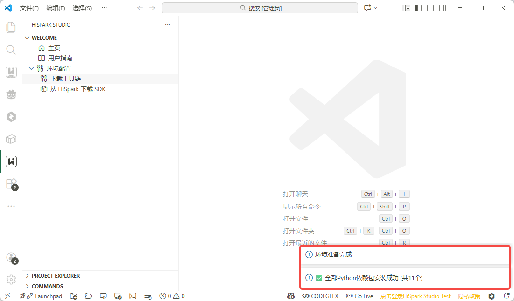
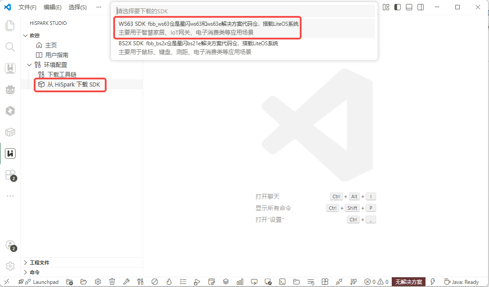
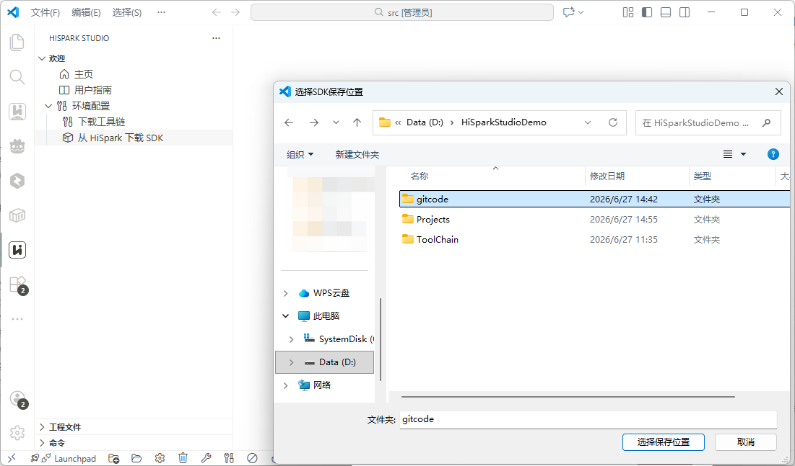
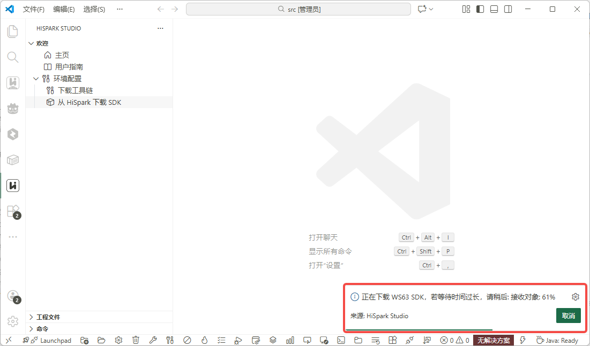

# 在 Windows 上配置 WS63 开发环境

根据使用方式选择开发环境配置方案：

- **VS Code 插件**：通过图形界面创建工程、构建和烧录固件。
- **CLI**：使用 PowerShell 命令完成环境准备和构建。

## 场景一：使用 VS Code 插件

### 环境要求

| 项目 | 要求 |
|---|---|
| 操作系统 | 64 位 Windows 10 或 Windows 11 |
| VS Code | 1.85.0 及以上 |
| 硬盘空间 | 至少 900 MB（安装 HiSpark Studio 插件） |
| 内存 | 最低 1 GB RAM（Random Access Memory），建议 4 GB 及以上 |
| CPU | 1.6 GHz 或更高 |
| C 盘空间 | 建议至少 1 GB 剩余空间 |
| 网络 | 需要网络连接，用于下载工具链和 SDK |

### 硬件配件

| 物品 | 用途 | 获取方式 |
|---|---|---|
| Type-C USB（Universal Serial Bus）数据线 | 连接开发板与电脑，用于供电和烧录 | 开发板通常自带 |

<a name="serial-driver"></a>

### 安装串口驱动

开发板通过 USB 转串口（USB-TTL）与电脑通信，用于烧录固件和串口调试。需要安装与开发板 USB 转串口芯片匹配的驱动；使用 CH340/CH341 芯片的开发板可安装 CH341SER 驱动。

访问 [CH341SER 驱动下载](https://www.wch.cn/downloads/CH341SER_EXE.html) 下载驱动包，双击进行安装。

### 安装 VS Code

1. 下载并安装最新版 [Visual Studio Code](https://code.visualstudio.com/Download)。

2. 安装简体中文语言包（可选）。打开 VS Code，进入扩展市场（快捷键 `Ctrl+Shift+X`），搜索 `Chinese`，选择中文简体插件并安装。安装完成后重启 VS Code 即可使用中文界面。本文以 VS Code 中文界面为例。

    

### 安装 Git

HiSpark Studio 插件的“从 HiSpark 下载 SDK”功能会优先使用本机 Git 下载 SDK。相关说明可参考 [HiSpark Studio for VS Code 用户指南 - SDK下载](../../../tools/HiSparkStudioforVSCodeUserGuide/HiSparkStudioforVSCodeUserGuide.md#ZH-CN_TOPIC_0000002303416852)。

如电脑尚未安装 Git，请参考 [Git 官方安装说明](https://git-scm.com/book/zh/v2/起步-安装-Git) 安装 Git。安装时建议保留将 Git 添加到命令行环境变量的默认选项；安装界面或选项变化时，以 Git 官方文档和安装向导为准。

安装完成后，关闭并重新打开命令提示符，执行以下命令确认 Git 可用：

```cmd
git --version
:: 输出示例: git version 2.x.x
```

> 如果命令提示“不是内部或外部命令”，说明 Git 未加入 `PATH`。请参考 Git 官方安装说明重新配置，或重新运行 Git 安装程序并选择将 Git 加入命令行环境的选项。

### 安装 HiSpark Studio 插件

WS63 开发推荐使用 `HiSpark Studio for VS Code` 插件，该插件提供代码编辑、编译、烧录和调试等一站式开发环境。

1. 打开 VS Code。
2. 进入扩展市场（快捷键 `Ctrl+Shift+X`），搜索 `HiSpark Studio`，安装 HiSpark Studio 插件。

    

3. 安装完成后，左侧活动栏会出现 HiSpark Studio 图标，单击即可进入插件界面。

    

### 安装工具链

HiSpark Studio 插件编译工程需要依赖工具链、Python 和 pip 依赖环境，可通过以下步骤下载安装。

1. 单击左侧 HiSpark Studio 图标进入插件界面，单击“下载工具链”。在弹出的窗口中选择保存目录，目录层级不要过深且不要包含中文字符，然后单击“选择保存位置”开始下载。

    

2. 安装过程会依次下载以下内容。

    | 安装项 | 说明 |
    |---|---|
    | Python 3.11.4 | 嵌入式 Python 环境 |
    | pip 依赖 | wheel、setuptools、cmake、kconfiglib、pycparser、pillow、numpy、opencv-python、windows-curses、ffmpeg-python、pyelftools、openpyxl、pandas 和 tkinter-embed |
    | 编译工具链 | WS63 使用的 RISC-V 交叉编译工具链及其他构建工具 |

3. 自动安装完成后，界面右下角会提示“环境准备完成”。

    

> **注意：**
>
> - 如果自动安装工具链时 Python 安装失败，通常是网络或本地代理问题，请更换网络或修改代理后重试。
> - 如果提示依赖下载失败，可重复执行“下载工具链”。
> - 多次尝试仍然失败时，按本页“场景二：使用 CLI 配置”完成环境配置。

### 获取 SDK

使用 HiSpark Studio 插件下载 SDK 前，需要先完成本节前述的 Git 安装和环境变量配置。

Windows 11 用户如需将 SDK 存放到开发盘，可按 [Windows（开发者驱动器）](dev-drive.md)准备存储位置。

1. 在 HiSpark Studio 插件页面单击“从 HiSpark 下载 SDK”，在下载列表中选择 `WS63 SDK`。

    

2. 选择 SDK 保存位置。建议选择空文件夹，路径不要太深且不要包含中文字符。

    

3. 右下角会显示下载进度，等待下载完成。

    

## 场景二：使用 CLI 配置

<a name="cli-setup"></a>

### 安装 CLI

在 PowerShell 中安装 CLI：

```powershell
irm https://dl.hispark.hisilicon.com/bootstrap.ps1 | iex
```

重新打开 PowerShell 后检查版本：

```powershell
fbb -V
```

WS63 SDK 要求 `fbb` 不低于 `1.1.0`。

### 获取 SDK 和准备工具链

使用 CLI 获取 SDK：

```powershell
fbb sdk install ws63
```

已有 SDK 时，进入 SDK 的 `src` 目录，将 `<SDK安装目录>` 替换为实际路径：

```powershell
cd "<SDK安装目录>\src"
```

准备工具链和构建依赖：

```powershell
fbb setup --sdk-dir .
```

检查环境：

```powershell
fbb doctor
```

```powershell
fbb describe --json
```

## 常见问题

### Q：端口无法识别？

A：确认开发板使用的 USB 转串口芯片及对应驱动，重新插拔 USB 数据线，并检查设备管理器中是否出现串口设备。

### Q：烧录失败？

A：按以下顺序检查：

1. 确认开发板已进入烧录模式。
2. 检查串口连接和端口选择是否正确。
3. 确认串口驱动已正确安装。
4. 尝试更换 USB 数据线或 USB 端口。
